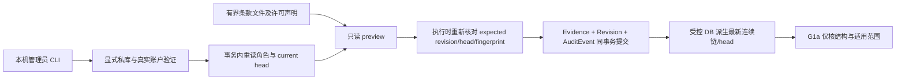

# G1b：可信外部事实许可的持久治理与本机 CLI

状态：已按 Root 授权完成静态实现，等待独立受支持运行时与隔离私库验收；本说明不代表测试已执行。目标是本轮可实现、可用私库实际验收的治理闭环：两张追加表、受控当前 head、管理员 CLI preview/approve/restrict/withdraw、UUID 幂等与同事务审计。不是 G2 查询路由，也不自动产生任何真实来源的 approved。

基线：HANDOFF R107，114,286 B / `3ea90158c012717e6b45e8c7e49e162340a3e89f42e720b0090a23bab50b7e37`。G1a 产品 `f473bfc5f83379802a1d6493ec48d6bd778fb038622b4a2c8a46e95b5965721d`、测试 `f6aa417bfea8f14159d3c82dffe01da0fd35a3b98225b4de38c4c9997971933d` 保持。G1a 成功仅合成纯核验收，当前 main/SQLAlchemy/WMI 应用入口尚未恢复。设计决定与证据 pins 见 `.artifacts/external-fact-governance-contract-20261021/DECISIONS.md`、`source-pins.json`。

## 1. 已核现状与不扩范围

- `source_settings.py:219–289` 已有 preview、expected revision/fingerprint、UUID 幂等、追加修订和审计；`source_materials.py:221–289` 在提交/发布前复核真实用户与管理员角色。复用语义和模式，不复用其许可结论。
- `source_material_models.py:37–65` 有 SQLite update/delete/replace 防护与 ORM guard；`migrations.py:265–280` 还为材料表安装 PG update/delete 触发器。新表需双后端保护，不能只抄 ORM guard 或遗漏 SQLite REPLACE。
- `service.py:58–61` 的 AuditEvent 是可在同事务添加的既有审计镜像；`:458–465` 短事务使用 SQLite BEGIN IMMEDIATE / PG advisory lock 821741905。但旧 lock_ingestion 会先 commit，不可在本切片已有事务中直接调用。
- `manage.py:53–57` 进入 create_app/initialize；不能挂接成此次 CLI 的普通分支。`Database.initialize:512–554` 注册模型、create_all、upgrade 及搜索/向量初始化；新 CLI 不能调用它，也不读取默认 DB/env。
- 现有最高迁移为 `024_vehicle_binary_raw`（vehicle_binary_migration.py:19；migrations.py:331–338）。本计划暂定 **025_external_fact_governance**；实施前重读编号，若并行占用则顺延并统一所有引用，不改旧编号。

仅处理 `external_structured_fact_read`。采集 enable/pause/archive、fallback consent、Provider、原件 export、材料保存/重开/quote 互不授权。没有新 HTTP 管理接口、外部 facts 路由、scope、SDK、UI、通用许可 DSL、通用原件库或分段链。

## 2. 架构及信任边界

真实账户身份必须来自私库 User 的密码验证及 is_admin，不能通过 `--actor-user-id`、用户名、operator 标签或 JSON reviewer 字段冒充。CLI 是本机工作区管理入口，仍信任本地 OS/数据库文件运维权限；不能抗 DB owner/superuser、改解释器、替换整个库或禁用触发器。生产 IAM、远程登录、服务器部署不在验收范围。

复用 auth.verify_password；口令仅用 getpass 从真实 TTY 输入，不从 argv/env/request file 读取、不落日志，非 TTY 缺少安全输入时固定失败。自动测试在函数边界注入合成凭据/输入，不增设产品 bypass。服务接收受认证的内部 actor context，写锁内重读用户、is_admin，并确认密码凭证未在认证后变更；仅持 actor id 不形成可用授权。actor context 不可序列化为长期 token，不保存明文口令/密码 hash 到新表、preview 或错误。

历史 actor_user_id 与用户名快照记录实际批准者，不以会话当前 user_id 重建归属；账号后来改名/降级/删除不自动改写既有许可。后续写入需重新认证；撤销许可由显式 restrict/withdraw 完成。该 actor 是治理审阅者，不是 G2 查询数据的 owner。

## 3. 最小两表合同

### 3.1 ExternalFactLicenseEvidence / external_fact_license_evidence

不可变的小型条款证据，字段：`raw_hash`（SHA-256小写hex主键）、`byte_count`、`body`（LargeBinary）、`created_at`。仅接受1–262144字节严格UTF-8条款文本/受控审阅声明，拒绝NUL及无效编码；不处理产品原文、HTML抓取、PDF/图片、OCR、压缩包或下载。

同 hash 已存在时必须核实际字节数及内容 hash 一致，复用；不 REPLACE、不更新。G1a `rights.evidence_reference` 由服务生成 `external-fact-license-evidence:sha256:<hash>`，`evidence_sha256` 必须一致。原始本机文件路径不持久化或回显。许可证来源引用由 revision 的 `license_reference` 有界字段记录，引用仅是操作者声明，不联网核真伪。

此表与 Snapshot/ObjectStore 不同：它保存条款/审核声明，不能充当轮胎采集证据或绕过材料 rights。Snapshot 继续保留既有业务观察；ObjectStore 不新增对象、URL、导出入口或权限。条款 hash 只认证已提供字节的一致性，不认证发布者/法律适用。

### 3.2 ExternalFactGrantRevision / external_fact_grant_revisions

每条是完整追加修订，最低字段：

| 字段组 | 内容 |
|---|---|
| 主键/索引 | id；grant_id；source_id；revision；UNIQUE(grant_id,revision)；source_id索引 |
| G1a记录 | 完整 `record` JSON、record_digest、previous_digest；schema/purpose固定、grant/source与列完全一致 |
| 许可证据 | evidence_sha256 FK→evidence.raw_hash；license_reference（公共条款引用，≤2048，禁止userinfo/secret引用）；与record rights精确对应 |
| 实际绑定 | binding_receipts JSON：每观察固定Snapshot/Verification/QueryRun引用及 source/query_key/raw_hash/parser_version/parser_identity摘要（未知显式null），不填造凭证 |
| 操作身份 | action approve/restrict/withdraw；actor_user_id、actor_username_snapshot；reason（有界）；created_at |
| 乐观并发 | expected_revision、expected_head、preview_fingerprint；初始0/null；后续精确前件 |
| 幂等 | idempotency_key为规范UUID；UNIQUE(actor_user_id,idempotency_key)；request_hash |
| 审计闭合 | audit_event_id FK→AuditEvent.id且unique；event_digest覆盖固定全部元数据、record_digest、证据/绑定和audit id |

record 的 reviewer 必须由真实 actor_user_id 填写，reviewed_at 由服务 UTC 秒时钟填写；客户端不得传 reviewer/revision/previous_digest/state/digest/真实批准时间。validity/rights/coverage 属管理员待审意图，必须严格有界。record/state由 action映射，结构完全复用G1a，不改纯核。

无第三张 mutable-head 表。`current head`是受控数据库中该 grant 的唯一最高 revision，经完整连续链/事件/审计镜像/当前条款字节验证后派生。缺链、跳号、列/JSON不符、坏 hash、缺审计、坏当前 evidence 均固定 fail closed，不退旧approved、不读备份、不接受客户端替代链。

## 4. approve 必须核真实业务观察绑定

新批准必须先有正式 Snapshot，不从请求创建 Snapshot/Verification/QueryRun，也不联网/解析补证据：

1. 请求 source_id 与每个 Snapshot.source_id 精确一致，snapshot_id 实存且唯一。
2. 请求三元组 raw_hash/parser_version 与 Snapshot 相同，按既有 field_evidence 规则核 `SHA256(snapshot.body UTF-8)`，不得把解码后的 body hash 称为原始 HTTP 原字节 hash。
3. 存在 status=ok/not_modified 的 Verification，snapshot/source/query_key一致；其 QueryRun 存在且 source/query_key一致，digest(QueryRun.query)==query_key。parser_identity 若存在须与快照匹配，缺失保持明确缺失，不编造已验证Parser身份。
4. 把实际选用的 receipt 引用写入 binding_receipts。全次最多256观察、原文重验总量≤32MiB；超预算固定失败，不跳过或截断。单条record编码≤128KiB，整链读取≤32MiB，超限不放行。
5. `field_keys` 仍只是G1a规范键和许可覆盖，不冻结九facts/身份DTO；此步骤不证明精确成员、当前identity、字段值或G2账户可见性。将来G2仍必须重验自身证据闭包，许可记录不能覆盖事实损坏或身份撤销。

rights_reviewed 必须为显式 true，操作者承担对条款真实性、权利人、用途、商业条件和附加义务的实际审核；代码只核已提供声明/字节及业务绑定。文件存在、真实账号登录、G1a applicable 或 agent 实现同意都不能代替法律审核。无真实材料时仅用合成fixture测工程，不seed真实approved。

## 5. 状态、容量和撤回

- 初始不存在=revision0/head null，绝不默认为approved。approve可建立首条approved；restrict可建立首条restricted（也需完整受控声明/绑定）；withdraw仅对既有grant。
- 同grant内source_id固定。approved可approve（明确新完整修订）、restrict、withdraw；restricted可approve/restrict/withdraw。相同内容和相同原因的无变化操作固定拒绝，幂等重放除外；明确不同的完整复核原因可追加approve修订。
- **withdrawn为本切片同grant终态**，不可再approve/restrict。同来源若将来获得新的独立许可，需要新grant_id、完整新预览/审核/批准，不复制旧批准状态；不宣称撤回一个grant即全站永久封禁。G2将由服务器选择适用grant，不让客户端head指定旧修订。
- G1a只支持完整≤256修订，非withdraw最多写到255；第256仅允许withdraw。到255时继续approve/restrict固定capacity错误，仍能撤回；withdraw后终态。没有分段链/checkpoint/自动轮转。
- restrict/withdraw仅克隆当前合法覆盖/rights/validity、更新状态/reviewer/time/链前件，不接收扩大字段/换来源/换证据的混合payload，不要求联网或重验全部业务原文才能停止许可。若账本已损坏，读取本已拒绝；另走故障修复，不临时跳过链验证写假撤回。

## 6. 事务、当前head与幂等

公开读入口 `store.current_policy_transaction(grant_id)`：它自己取得新会话和短事务锁，从DB加载当前链/证据/审计并派生 expected_head；不接收客户端records/head。锁在context退出前保留；G2未来要在同一上下文调用G1a并完成许可裁剪/投影，以定义读取与撤回的线性化。不能缓存ValidatedPolicy跨请求。管理current读回通过服务UTC时钟显示G1a applicability/reason，过期approved保留历史状态但不显示适用。

SQLite短事务第一语句 BEGIN IMMEDIATE；PG复用821741905事务级advisory lock模式，并通过FOR UPDATE锁定事务内复查的管理员行，防止其他不取治理advisory锁的角色修改者穿插撤权。先锁后读，均用新会话/expire状态；不要调用会先commit的QueryService.lock_ingestion。允许本机粗粒度串行以保持最小实现，不加锁服务/队列/Redis。事务与回滚由唯一store边界拥有，不从下层helper偷偷commit。

写入顺序：

1. 在事务外有界读取申请/条款文件到内存并hash，无网络；完成TTY账号验证。
2. 开新事务先锁，重读账户角色/凭证版本；从DB加载当前可信链/head。
3. 查(actor,idempotency_key)。相同UUID异payload固定冲突；同payload已有成功操作则只回历史event摘要与**当前**state/head，不再写evidence/revision/audit，不把历史approved当当前许可。
4. 对新操作校验expected_revision/head等于DB当前值，重算preview_fingerprint并精确匹配；检查状态/撤回槽。仅新approve检查现在有效期、rights_reviewed与实际绑定；restrict/withdraw不要求当前许可适用，expired/not_yet_valid/截止等号仍可停止许可。
5. 创建/复用有界条款行；服务填record前件、reviewer/时间/digest，调用G1a验证新完整链。
6. 添加AuditEvent镜像与revision，flush后再核闭合，单次commit。任一故障整体rollback；不留下只有evidence/审计、缺revision或半个head。

preview需认证但只读：不创建批准/修订/审计/用户会话、不消费UUID、不写证据或权限。fingerprint覆盖规范意图、actor_id、当前revision/head、条款hash、实际绑定摘要和容量结果，排除提交时才生成的id/时间。执行时重算并重新检查有效期/角色，旧preview不授予权限；它只是精确人工确认材料，不是bearer capability。

规范UUID严格比较拼写，不静默纠正；request_hash含全部规范意图和并发前件。撤回后重放旧批准UUID时：replayed=true、historical_event_id保留、current_state=withdrawn/current_head为最新，不追加、不恢复。返回固定码/安全元数据，错误不回显口令、条款正文、路径、申请JSON或数据库URL。

AuditEvent使用 `session_id=fact_cli:<UUIDhex>` 作为明确CLI关联标识（现有列无FK，不伪造浏览器会话），action=`external_fact_policy_changed`。实际actor锚在不可变ledger。event_digest与audit detail采用无循环固定映射，读时交叉核对。旧AuditEvent只有ORM全局保护，不能声称其既有所有行具有新表的native不可变性；ledger自身是权威治理审计。

## 7. 数据库防护与025安装

新两表均加ORM before_flush guard及数据库级防护：SQLite使用WITHOUT ROWID排除隐藏rowid替换路径，BEFORE UPDATE/DELETE拒绝，BEFORE INSERT按所有主键/唯一键冲突拒绝以堵INSERT OR REPLACE；recursive_triggers=OFF同样受保护。PG BEFORE UPDATE/DELETE逐行拒绝，BEFORE TRUNCATE逐语句拒绝；ON CONFLICT DO UPDATE也不能改历史。普通事务失败后rollback可继续读当前值。

限制：这些防护不是针对DB owner/superuser/禁用触发器/替换文件的防篡改认证，新增INSERT仍依赖受控写入口和数据库访问边界。loader校验链/actor元数据/审计闭合不能把任意DB写权限变成可信外部用户权限。

实现 `external_fact_models.install_schema(connection)` 只创建两表与其guard；025块在现有024校验/登记后调用并最后登记025。db.py仅新增模型注册。全新Base.metadata.create_all路径也需after_create安装相同双后端guard，避免只在升级库有防护；安装应幂等、DDL名称固定、不用用户输入拼表名。

独立CLI的 `init-private` 仅允许显式私有SQLite文件及全新backup路径、offline确认，校验已有核心表/024形状及版本，并核store连接实际main文件等于待备份文件。backup API源/目标连接显式close，摘要以1MiB chunk流式计算；备份后仅安装025，安装失败保留备份并回滚事务。不调用Database.initialize/create_app/整个upgrade，不自动执行024重建、旧迁移、搜索或向量初始化。新测试私库用显式合成fixture建必需core表及满足未patch 024 classifier的结构；这不是023→024历史迁移验收。普通preview/approve/restrict/withdraw只要求025已存在，绝不自动初始化/迁移。

PG在本轮交付SQLAlchemy模型/DDL可编译与约束/触发器定义审查，若无显式隔离PG则标未运行，不把compile当PG并发/native触发器实际验收；本机CLI首版仅SQLite私库。正常库部署/迁移另行保全与授权执行，本轮不启动正常API或库。

## 8. 文件所有权与执行顺序

| 顺序 | 文件 | 最小任务 |
|---|---|---|
| B1 | 新建 apps/api/tire_api/external_fact_models.py | 两表、约束、双后端guard及install_schema |
| B2 | 新建 apps/api/tire_api/external_fact_governance.py | 受控store、当前链加载、preview、append、绑定、审计、事务与固定错误 |
| B3 | 新建 apps/api/tire_api/external_fact_governance_cli.py | 独立显式私库CLI、TTY认证、严格有界文件输入、init-private/current/preview/approve/restrict/withdraw |
| B4 | 修改 apps/api/tire_api/db.py、migrations.py | 仅注册两模型/025块；核当时编号及dirty diff，不覆盖并行变更 |
| B5 | 新建 apps/api/tests/test_external_fact_governance.py | SQLite私库服务/并发/原生SQL/回滚与PG DDL目标测试 |
| B6 | 新建 apps/api/tests/test_external_fact_governance_cli.py | 真账户认证接口、CLI解析/secret安全/显式路径/旧入口不可达/重放语义 |
| B7 | 最小修改 apps/api/tests/version_registry.py、historical_migration_support.py | Root授权扩展归属：追加025版本与两新表独立字面量触发器合同，保留其他dirty |
| B7 | 新建 docs/EXTERNAL-FACT-GOVERNANCE.md | 有效命令、私库/真实许可/撤回与失败恢复限制；只在实际验证后写真实结果 |

实现worker负责上述产品/测试，明确不是唯一agent；另独审者只审最终pins/回执，不改产品。G1a、auth/manage旧功能、source/material/provider/fallback、SDK/UI/main路由不修改。无需新增依赖或大规模公共模块抽取。

CLI命令合同：`python -m tire_api.external_fact_governance_cli <init-private|current|preview|approve|restrict|withdraw> --private-database <显式绝对私库文件> ...`。preview带action及有界request-file（approve/restrict首条另带terms-file）；提交带规范UUID、expected-revision、expected-head（首条显式null语义）和expected-preview-fingerprint。各读写命令均需username及TTY密码。命令示例不得含真实账号口令或DB秘密，不提供默认正常库/env后门。

## 9. 本轮验收与故障向量

先由运行时agent交付受支持、独立官方解释器/依赖及审过的隔离入口。G1b确实需要SQLAlchemy/SQLite，使用显式新私库白名单和清env；不得借G1a成功宣称main可导入，也不通过放宽旧诊断Guard运行正常库。隔离测试不启动HTTP/Provider/网络，禁child与未知DB路径，使用真实新回执，旧run不重跑/不补造。

必要目标矩阵：

- 真实合成User：admin密码正确成功；匿名/不存在/非admin/只传actorid/错密码/认证后降级或换密码均拒绝；口令/credential hash/本机文件路径不进入新表或输出，历史username snapshot确实保存。非TTY无产品绕过。
- preview前后两新表/AuditEvent/会话行数不变；改terms字节/绑定/actor/currenthead/意图后旧fingerprint失效；preview不是批准。
- snapshot/source/hash/parser错任一、原文hash坏、缺正式receipt、query_key不符、Parser未知不被编造、超32MiB/记录容量均有明确拒绝；不自动采集修复。
- 连续approve→restrict→withdraw后current读取最新；客户端旧head/旧chain无法输入current-reader；撤回提交后新读不返回旧approved；同事务锁下并发读/撤回线性化。
- 同UUID同payload只一次revision/audit；不同payload冲突；同actor跨session/重启仍幂等；withdraw后重放旧approve返回当前withdrawn且无新写；withdrawn新UUID也不能复活同grant。
- 两连接并发同expected revision只有一个提交；失败者无孤立evidence/audit。两进程仅在隔离runner明确批准owned child时另验，不在禁止child的工装里假装已测。
- 第255非withdraw容量拒绝，第256withdraw仍可提交；超256链拒绝；无自动checkpoint/轮转。
- 故障注入 after_evidence/after_audit/after_revision/before_commit，所有行和head回滚一致；断线后UUID重试查询已提交与未提交两种实际终态。
- ORM改删、raw UPDATE/DELETE、SQLite INSERT OR REPLACE/冲突IGNORE/UPSERT、recursive_triggers OFF均不能改新两表；PG定义须覆盖UPDATE/DELETE/TRUNCATE，实际PG若未跑单独声明。
- 坏chain/坏列-JSON映射/坏event_digest/坏audit镜像/缺evidence/hash坏/current缓存污染均fail closed，不退旧许可。
- 私库025安装重复幂等、失败事务rollback、不替换旧表/旧版本；备份及历史数据读回；PG模型DDL独立编译，外部API旧sources/webhooks边界在受支持隔离入口可用后做最小回归，不启动正常服务。

完成口径：两表+CLI+可信head可在显式私库实际执行上述相关目标，报告实际命令/终态/关键pins/未跑PG等限制。合成approved仅工程fixture；没有经核对的真实许可证据就不登记真实approved，更不注册G2事实路由。实现/私库工程验收与真实来源许可证据分别记账。

## 10. 回退与本文件状态

未接路由时回退是停止使用新CLI；保留已追加治理记录及审计，不DELETE撤回、不原地恢复旧approved。私库演练失败回滚事务/保留独立备份和回执；正常库不在此方案中执行down migration。产品代码回退需人工复核受影响新文件及两注册点，不覆盖其他dirty。

本文件及ADR本轮仅静态设计。未运行Python/测试/DB/服务/网络/Provider、未读env/secrets、未改变G1a或历史产物；没有声称025已执行、CLI已可用、真实来源许可已取得或应用入口恢复。
